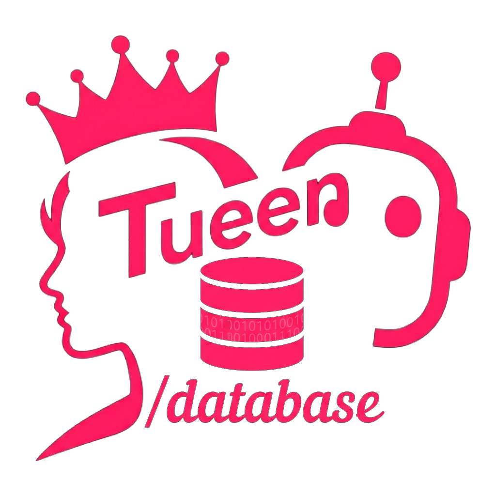

<p align="center">
  <a href="https://github.com/tueen/database">
    
  </a>
</p>

<h1 align="center">Tueen Database 👑</h1>

<p align="center">
  <strong>The Zero-Config, High-Throughput Relational Engine for Modern Telegram Bots</strong><br>
  <em>Part of the Tueen ecosystem — "The Queen of Telegram"</em>
</p>

<p align="center">
  <a href="https://php.net"></a>
  <a href="LICENSE"></a>
  <a href="https://www.doctrine-project.org"></a>
  <a href="phpunit.xml.dist"></a>
  <a href="phpstan.neon"></a>
</p>

---

**Tueen Database** is an enterprise-grade, zero-config relational database layer crafted specifically for high-throughput Telegram bots. Built on **PHP 8.4+** and **Doctrine ORM 3**, it works seamlessly both inside the **Tueen Bot Framework** and as a high-performance standalone library.

---

## ⚡ Highlights

- 🚀 **Declarative Zero-Config Schema Synchronization:** Automatic lazy schema diff synchronization on boot — no manual CLI migrations required!
- 🪝 **Modern PHP 8.4 Architecture:** Property hooks, asymmetric visibility (`public private(set)`), native lazy objects, and backed enums.
- 💬 **Telegram-Native Domain:** Built-in models for chats (64-bit signed IDs), users, channels, groups, messages, contacts, and bridging relays.
- 💳 **Multi-Currency Ledger & Billing:** Arbitrary-precision wallets (TON, Stars, USDT, fiat), double-entry transactions, orders, discounts, and subscriptions.
- 📦 **Plug & Play Multi-Database Support:** SQLite (in-memory & file), MySQL 8+, MariaDB, and PostgreSQL out of the box.
- 🏎️ **Tiered Caching:** PSR-16 SimpleCache database store + Redis/APCu Doctrine metadata and query caching.
- 🧩 **Extensible:** Register custom entity paths and third-party migrations effortlessly.

---

## 🚀 Quickstart

```bash
composer require tueen/database
```

```php
use Tueen\Database\Config\DatabaseConfig;
use Tueen\Database\DatabaseManager;

// Initialize with zero-config auto-migration (SQLite file or :memory:)
$db = DatabaseManager::create(DatabaseConfig::createSqlite(':memory:'));

// 1. Find or create a Telegram user
$chat = $db->chats()->findOrCreate(
    chatId: 123456789,
    username: '@telegram_user',
    name: 'Alice',
);

// 2. Perform atomic wallet credit
$tx = $db->wallets()->credit($chat, '50.000000000000000000', 'TON', 'welcome_bonus');

// 3. Store global bot options and configuration
$db->options()->set('maintenance_mode', false, 'system');
```

---

## 🛠️ CLI Tooling

Manage your schema, status, and caches with the bundled `tueen-db` CLI:

```bash
# Verify schema & entity mappings
php bin/tueen-db tueen:db:validate

# Inspect engine status
php bin/tueen-db tueen:db:status

# Synchronize schema diffs
php bin/tueen-db tueen:db:sync

# Clear caches
php bin/tueen-db tueen:cache:clear
```

---

## 📖 Complete Documentation

Exhaustive documentation, architecture deep dives, entity guides, and interactive diagrams are available in the **[VitePress Documentation Suite](docs/)**.

```bash
cd docs
npm install
npm run docs:dev
```

---

## 📄 License

Tueen Database is open-sourced software licensed under the **[MIT License](LICENSE)**.
