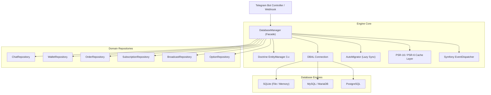

# Architecture & Engine Overview

Tueen Database is architected around the principles of high concurrency, zero-maintenance operations, and strict domain boundaries.

---

## 🏛️ Core Architecture Diagram

The diagram below illustrates how incoming Telegram updates flow through the Tueen Database layer:

---

## 🧩 Key Architectural Principles

### 1. Unified Engine Facade (`DatabaseManager`)
The `DatabaseManager` acts as the single entry point. It manages:
- **Connection pooling & platform configuration** (SQLite WAL concurrency, MySQL `utf8mb4`, PostgreSQL search paths).
- **Doctrine EntityManager bootstrapping** with attribute mapping and PHP 8.4 native lazy ghost objects.
- **Zero-config auto-migration checking** on boot or first repository access.
- **Fluent access to domain repositories** (`$db->chats()`, `$db->wallets()`, etc.).

### 2. PHP 8.4 Language Advancements
Tueen Database was designed from the ground up for modern PHP 8.4+:
- **Property Hooks:** Computed values (e.g. `$chat->displayName`, `$order->totalAmount`, `$withdrawal->netIncome`, `$subscription->isActive`) are computed directly on property read, avoiding verbose getter boilerplate.
- **Asymmetric Visibility:** Identifier fields (`public private(set) int $id`) are publicly readable throughout the app, but cannot be accidentally mutated outside entity lifecycle methods.
- **Native Lazy Objects:** Eliminates legacy proxy generation files and memory bloat by delegating proxy mechanics directly to the PHP 8.4 engine.

### 3. Telegram Domain Invariants
- **Signed 64-bit BigInts:** Telegram chat IDs for channels, supergroups, and groups are negative numbers (e.g. `-100192837465`). Using unsigned integers causes database truncation or overflow. Tueen Database enforces signed 64-bit integer columns across all platforms.
- **Emoji & Multi-Byte Text:** All textual fields default to `utf8mb4` character set and collation, ensuring seamless storage of custom Telegram emojis and multi-language usernames.

---

## 🧭 Next Steps

- Understand how **[Zero-Config Auto-Migrations](/guide/zero-config-migrations)** eliminate manual schema management.
- Configure **[Multi-Database Connections](/guide/multi-database)** for your infrastructure.
