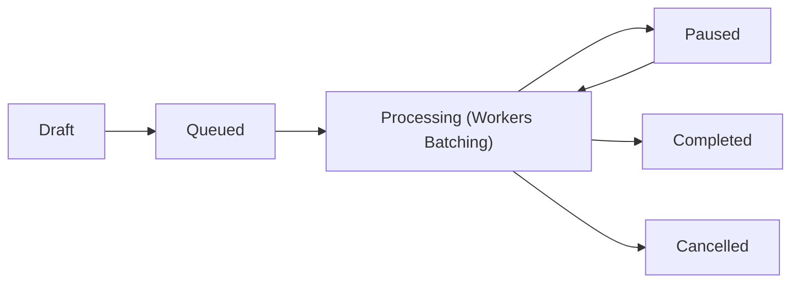

# High-Volume Broadcast Engine

Broadcasting messages to thousands or millions of Telegram chats requires reliable chunking, offset tracking, chat type filtering, and real-time delivery telemetry.

---

## 📢 The `BroadcastMessage` Entity

A `BroadcastMessage` manages a mass messaging campaign:



### Key Attributes:
- **`sourceChatId` & `sourceMessageId`:** References the original admin message to forward or copy.
- **Filters:** `allowPrivateChats`, `allowGroupChats`, `allowSupergroupChats`, `allowChannelChats`, and `excludedChatIds`.
- **Offset Cursor (`lastOffset`):** Remembers the last processed chat ID. If a worker process restarts or times out, it resumes exactly where it left off without duplicate deliveries.
- **Telemetry:** Real-time counters for `sentCount`, `failedCount`, and `ignoredCount`.
- **Property Hooks:**
  - `$broadcast->progressPercentage`: Computed percentage (0.0% to 100.0%).
  - `$broadcast->isFinished`: True if terminal state reached.

---

## 🛠️ Executing a Broadcast Campaign

### 1. Creating the Broadcast

```php
use Tueen\Database\Entity\BroadcastMessage;
use Tueen\Database\Enum\BroadcastStatus;

$broadcast = new BroadcastMessage(
    sourceChat: $adminChat,
    sourceMessageId: 1045,
    status: BroadcastStatus::Processing,
    allowPrivateChats: true,
    allowGroupChats: false,
);

$db->getEntityManager()->persist($broadcast);
$db->getEntityManager()->flush();

// Count total matching recipients
$total = $db->broadcasts()->countTargetChats($broadcast);
$broadcast->initialChatCount = $total;
$db->getEntityManager()->flush();
```

### 2. Chunked Delivery Loop (Worker Job)

```php
while (!$broadcast->isFinished) {
    // Fetch next batch of 100 recipients beyond lastOffset
    $chats = $db->broadcasts()->fetchNextPendingBatch($broadcast, batchSize: 100);

    if (count($chats) === 0) {
        $broadcast->status = BroadcastStatus::Completed;
        $db->getEntityManager()->flush();
        break;
    }

    $lastId = $broadcast->lastOffset;
    $sent = 0;
    $failed = 0;

    foreach ($chats as $chat) {
        $lastId = $chat->id;
        try {
            // Send telegram copy message...
            $sent++;
        } catch (\Throwable $e) {
            $failed++;
        }
    }

    // Persist progress and update offset cursor
    $db->broadcasts()->updateProgress(
        broadcast: $broadcast,
        lastChatId: $lastId,
        sentIncrement: $sent,
        failedIncrement: $failed,
    );

    echo "Progress: {$broadcast->progressPercentage}%\n";
}
```

---

## 🧭 Next Steps

- Organize hierarchical items with **[Content Entities & CMS](/guide/content-entities)**.
- Configure global settings using **[Options & State Cache](/guide/options-and-cache)**.
