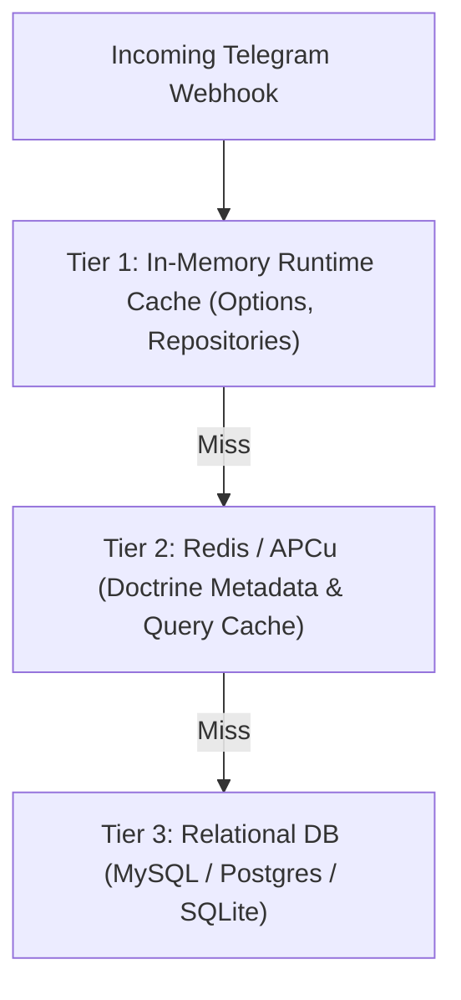

# Caching & Performance Tuning

High-throughput Telegram bots process hundreds of webhooks per second during viral events, marketing campaigns, or active chat group discussions.

Tueen Database is optimized for sub-millisecond query execution through a multi-tier caching architecture.

---

## 🏎️ Multi-Tier Caching Architecture



### Tier 1: Process-Level In-Memory Cache
- `OptionRepository` automatically holds retrieved options in a static array.
- Redundant calls to `$db->options()->get('key')` within the same webhook execution incur **0 microseconds of I/O latency**.

### Tier 2: Doctrine ORM Metadata & Query Cache
Doctrine metadata reflection can be cached in Redis, Filesystem, or APCu:

```php
use Tueen\Database\Config\DatabaseConfig;
use Tueen\Database\DatabaseManager;

$config = new DatabaseConfig(
    connection: ...,
    cacheDriver: 'redis',
    cacheDsn: 'redis://127.0.0.1:6379',
);

$db = DatabaseManager::create($config);
```

---

## 🗄️ Database-Specific Hardening

### SQLite Concurrency Hardening
When using SQLite file databases, Tueen Database applies the following connection flags on startup:
1. `PRAGMA journal_mode = WAL;` — Allows concurrent readers without blocking writers.
2. `PRAGMA busy_timeout = 5000;` — Retries busy locks for up to 5 seconds before throwing.
3. `PRAGMA foreign_keys = ON;` — Guarantees relational integrity.

### MySQL Index Optimizations
- All critical queries are covered by composite indexes (e.g. `idx_chats_type_banned_accessible` on `(type, banned, accessible)`).
- Full table scans are avoided for message broadcasting and user lookups.

---

## 🧭 Next Steps

- Manage database operations with the **[CLI Tooling](/guide/cli-tooling)**.
- Learn how to **[Extend Entities & Schemas](/guide/extending)**.
