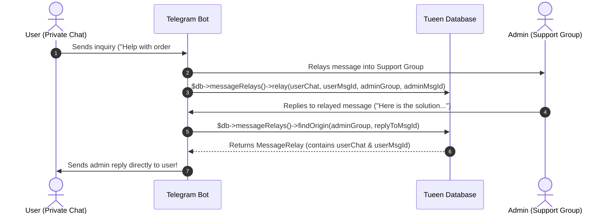

# Content Entities, CMS & Message Relays

Beyond user profiles and payments, Telegram bots often manage structured content catalogs (shop products, FAQs, blog articles, support tickets) and cross-chat communication relays.

Tueen Database provides a flexible Content Management System via **`EntityItem`** and bidirectional message bridging via **`MessageRelay`**.

---

## 🗃️ The `EntityItem` Model & Repository

An `EntityItem` represents an arbitrary typed content record (polymorphic content model):

- **`type`:** Discriminator string (e.g. `product`, `post`, `faq`, `ticket`, `lesson`).
- **`slug`:** URL/command safe identifier, unique per `type` (`(type, slug)` unique index).
- **`chat`:** Author or owner of the item (ManyToOne `Chat`).
- **`parent`:** Hierarchical parent (for sub-categories, replies, or nested trees).
- **`title` & `content`:** Text content supporting multi-byte emojis.
- **`status`:** Lifecycle status (`draft`, `published`, `archived`).
- **`extra`:** Free-form JSON payload for type-specific attributes.

### 1. Creating and Querying Content Items

```php
// Create a new content item using EntityItemRepository
$item = $db->entities()->create(
    chat: $adminChat,
    slug: 'vip-bot-license',
    type: 'product',
    title: 'Lifetime Bot License',
    content: 'Full access to the automated trading bot.',
    status: 'published',
);

$item->extra = [
    'sku' => 'LIC-2026-VIP',
    'download_url' => 'https://tueen.dev/download/vip',
];
$db->getEntityManager()->flush();

// Find an item by type and slug
$product = $db->entities()->findBySlug('product', 'vip-bot-license');
```

### 2. Social Feedback (`like` & `rate`)

Users can like or rate any content entity with automatic count tracking:

```php
// Like or unlike an item
$db->entities()->like($product, $userChat);
$likesCount = $db->entities()->getLikesCount($product);
$hasLiked = $db->entities()->hasLiked($product, $userChat);

// Rate an item (1 to 5 stars)
$db->entities()->rate($product, $userChat, score: 5);
$averageScore = $db->entities()->getAverageRating($product);
$totalRatings = $db->entities()->getRatingsCount($product);

echo "Product Rating: {$averageScore} / 5 ({$totalRatings} reviews)\n";
```

---

## 📬 Cross-Chat Message Relays (`MessageRelayRepository`)

A common architectural challenge in Telegram bots is building **Support Ticket Bots** or **Feedback Channels**:
1. A user sends a private message to the bot.
2. The bot forwards/relays the message into an **Admin Supergroup**.
3. When an admin replies to that message in the supergroup, the bot must know **which user** and **which message** to reply to!

The **`MessageRelay`** entity stores an indexed, bidirectional mapping between `(chat1, message_id1)` and `(chat2, message_id2)`:



### Code Example: Implementing the Relay

```php
// Step 1: When user sends a message, relay it to the support channel and record the mapping
$userMsgId = $update['message']['message_id'];
$adminMsg = $telegram->sendMessage([
    'chat_id' => $supportGroupChatId,
    'text' => "📩 Support inquiry from {$userChat->displayName}:\n\n" . $update['message']['text'],
]);

$db->messageRelays()->relay(
    chat1: $userChat,
    messageId1: $userMsgId,
    chat2: $supportGroupChat,
    messageId2: $adminMsg['message_id'],
    message: ['text' => $update['message']['text']],
);

// Step 2: When an admin replies in the support channel, find the original user message
$replyToId = $update['message']['reply_to_message']['message_id'];
$origin = $db->messageRelays()->findOrigin($supportGroupChat, $replyToId);

if ($origin !== null) {
    // Deliver the admin's answer straight to the original user!
    $telegram->sendMessage([
        'chat_id' => $origin->chat1->id,
        'reply_to_message_id' => $origin->messageId1,
        'text' => "👨‍💼 Support Response:\n\n" . $update['message']['text'],
    ]);
}
```

---

## 🧭 Next Steps

- Store global configuration with **[Options & State Cache](/guide/options-and-cache)**.
- Track changes with **[Audit Trails & Histories](/guide/audit-histories)**.
