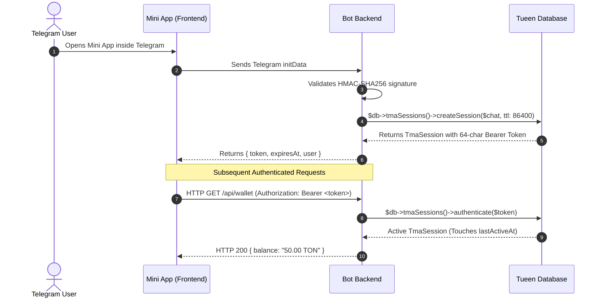

# Telegram Mini App (TMA) Sessions & Auth 🌐

**Tueen Database** provides a built-in, production-grade session management and authentication layer tailored specifically for **Telegram Mini Apps (TMAs)** and WebApps.

Modern Telegram bots increasingly serve full-screen web applications, Web3 crypto games, mini-stores, and interactive dashboards. Authenticating users securely from Telegram's `initData` and maintaining high-performance bearer sessions is essential.

---

## 🏛️ Architecture Overview

The session layer is backed by the [`TmaSession`](/reference/entities#tmasession) entity and managed through [`TmaSessionRepository`](/reference/repositories#tmasessionrepository).



---

## ⚡ Creating a TMA Session

After validating Telegram's `initData` signature on your backend, create a cryptographic bearer session:

```php
use Tueen\Database\DatabaseManager;

$db = DatabaseManager::create();

// 1. Find or create the Telegram chat/user
$chat = $db->chats()->findOrCreate(
    chatId: $telegramUser['id'],
    username: $telegramUser['username'] ?? null,
    name: $telegramUser['first_name'] ?? null,
);

// 2. Issue a secure session
$session = $db->tmaSessions()->createSession(
    chat: $chat,
    ttl: 86400, // 24 hours in seconds
    queryId: $initData['query_id'] ?? null,
    startParam: $initData['start_param'] ?? null, // Deep-link referral e.g. ref_123
    ipAddress: $_SERVER['REMOTE_ADDR'] ?? null,
    userAgent: $_SERVER['HTTP_USER_AGENT'] ?? null,
    payload: [
        'roles' => ['player', 'vip'],
        'theme' => 'dark',
    ],
    authDate: new \DateTimeImmutable('@' . $initData['auth_date']),
);

// 3. Return bearer token to frontend
echo json_encode([
    'token' => $session->token,
    'publicId' => $session->publicId,
    'expiresAt' => $session->expiresAt->format(\DateTimeInterface::ATOM),
]);
```

---

## 🔐 Authenticating Requests

In your API middleware or controller, authenticate the incoming bearer token:

```php
$token = $_SERVER['HTTP_AUTHORIZATION'] ?? '';
$token = str_replace('Bearer ', '', $token);

$session = $db->tmaSessions()->authenticate($token);

if ($session === null) {
    http_response_code(401);
    echo json_encode(['error' => 'Invalid or expired session.']);
    exit;
}

// Session is active and touched!
$userChat = $session->chat;
$customPayload = $session->payload;

echo "Authenticated user: " . $userChat->displayName;
```

> [!TIP]
> Calling `$db->tmaSessions()->authenticate($token)` automatically verifies that `$session->isValid` (`!isRevoked && !isExpired`) and touches `$session->lastActiveAt` to keep telemetry fresh.

---

## 🚪 Session Revocation & Logout

### Revoking a Single Session (Logout)
```php
$revoked = $db->tmaSessions()->revoke($token);
```

### Revoking All Sessions (Logout Everywhere)
When a user changes credentials or triggers security reset:
```php
$revokedCount = $db->tmaSessions()->revokeAllForChat($chat);
```

### Listing Active Devices/Sessions
```php
$sessions = $db->tmaSessions()->getActiveSessionsForChat($chat);

foreach ($sessions as $s) {
    echo "Device: {$s->userAgent} - Last Active: {$s->lastActiveAt->format('Y-m-d H:i')}\n";
}
```

---

## 🧹 Maintenance & Housekeeping

To keep the `tma_sessions` table lean and fast, schedule a cron or periodic job to purge expired sessions:

```php
// Deletes sessions where expires_at < NOW()
$deletedCount = $db->tmaSessions()->cleanupExpired();
```

---

## 🪝 PHP 8.4 Virtual Property Hooks

The `TmaSession` model utilizes PHP 8.4 property hooks for zero-overhead virtual checks:

```php
public bool $isExpired {
    get => $this->expiresAt <= new DateTimeImmutable();
}

public bool $isValid {
    get => !$this->isRevoked && !$this->isExpired;
}
```
