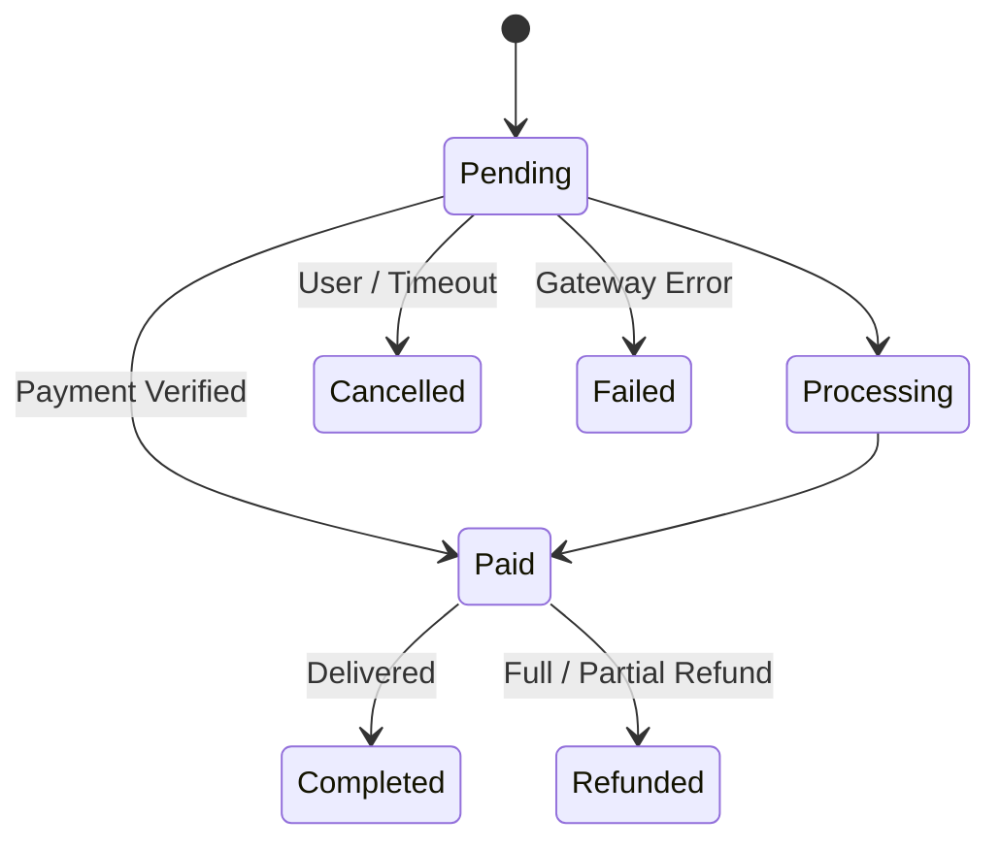

# Orders, Billing & Coupons

Tueen Database provides a comprehensive billing and commerce engine for Telegram bots selling digital subscriptions, physical goods, services, or VIP access.

---

## 🛍️ The `Order` Lifecycle

Orders follow a clear lifecycle transition represented by the `OrderStatus` backed enum:



---

## 📦 Creating & Managing Orders

### 1. Creating an Order

```php
use Tueen\Database\Enum\OrderStatus;

$order = $db->orders()->createOrder(
    type: 'pro_subscription',
    chat: $userChat,
    subtotal: '49.990000000000000000',
    currency: 'USDT',
    status: OrderStatus::Pending,
);

echo "Order Public ID: {$order->publicId}\n";
echo "Amount Due:      {$order->totalAmount} {$order->currency}\n";
```

### 2. Marking as Paid

When a payment gateway webhook confirms payment:

```php
$paidOrder = $db->orders()->markPaid(
    order: $order,
    transactionId: 'gw_tx_98127391823',
    referenceId: 'ref_102938',
);

if ($paidOrder->isPaid) {
    // Deliver purchased digital item or upgrade subscription
}
```

---

## 🎟️ Coupon & Discount Engine

Tueen Database supports percentage and fixed-amount discounts with usage limits:

### 1. Creating a Coupon

```php
use Tueen\Database\Entity\Coupon;
use Tueen\Database\Enum\CouponStatus;
use Tueen\Database\Enum\CouponType;

$coupon = new Coupon(
    code: 'TELEGRAM2026',
    title: '20% Welcome Voucher',
    type: CouponType::Percent,
    value: '20.000000000000000000',
    status: CouponStatus::Active,
    maxUses: 500,
    maxUsesPerUser: 1,
);

$db->getEntityManager()->persist($coupon);
$db->getEntityManager()->flush();
```

### 2. Applying a Coupon to an Order

```php
// Apply coupon code: automatically computes discount and saves snapshot
$db->orders()->applyCoupon($order, 'TELEGRAM2026');

echo "Discount Applied: {$order->discountAmount} {$order->currency}\n";
echo "Final Total:      {$order->totalAmount} {$order->currency}\n";
```

---

## 🧭 Next Steps

- Integrate recurring privileges with **[Subscriptions & VIP](/guide/subscriptions)**.
- Build mass engagement with the **[Broadcast Campaign Engine](/guide/broadcast-engine)**.
