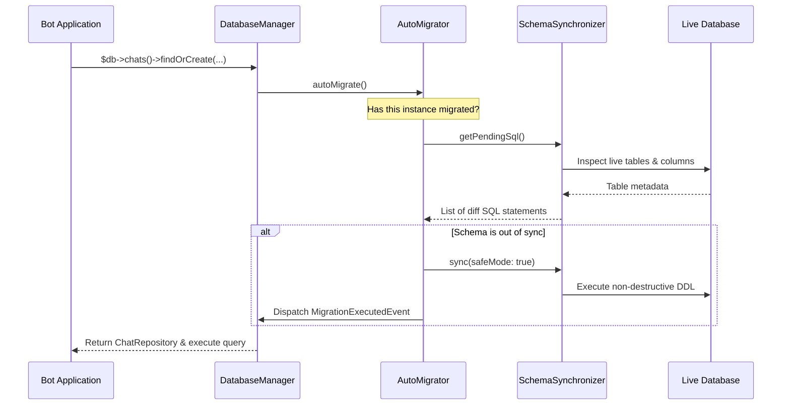

# Declarative Zero-Config Auto-Migrations

One of the defining innovations of Tueen Database is its **Declarative Zero-Config Schema Engine**.

---

## ⚡ The Zero-Config Concept

In traditional database frameworks, developers and server administrators must run CLI commands (such as `doctrine-migrations migrations:migrate` or `php artisan migrate`) whenever tables are added or modified. For Telegram bots, bot hosting panels, serverless environments, or plug-and-play plugins, this creates unnecessary operational friction.

Tueen Database solves this with declarative schema convergence: on bot boot or first database access, the engine compares the current database schema against Doctrine entity definitions and applies non-destructive updates automatically. No manual terminal commands or downtime needed.

---

## 🔄 How the Lazy Synchronizer Works

When `DatabaseManager` boots or any repository is queried:



---

## 🛡️ Safety Guarantees

1. **Safe-Mode DDL Only:**
   - `SchemaSynchronizer` executes in safe mode (`safeMode: true`). It will create missing tables, add new columns, and add new indexes.
   - It will **never** drop existing tables, columns, or foreign keys that might belong to other bot modules or legacy data.
2. **In-Memory Concurrency Caching:**
   - Once an application process has verified the schema, subsequent queries bypass the schema comparison, ensuring zero performance overhead on subsequent updates.
3. **Pluggable Migrations:**
   - Traditional versioned migrations (`Doctrine\Migrations\AbstractMigration`) are also supported via `migrations/` and the `tueen:db:migrate` CLI command for teams running automated CI/CD deployment pipelines.

---

## ⚙️ Configuration

Auto-migration is enabled by default. You can control this behavior via `DatabaseConfig`:

```php
use Tueen\Database\Config\DatabaseConfig;

$config = DatabaseConfig::createMysql(
    dbname: 'telegram_bot',
    user: 'bot_admin',
    password: 'secret',
    autoMigrate: true, // Set to false to disable zero-config auto-migration in strict production
);
```

---

## 🧭 Next Steps

- Learn about **[Multi-Database Setup](/guide/multi-database)** for MySQL, PostgreSQL, and SQLite.
- Explore the **[CLI Tooling](/guide/cli-tooling)** to inspect schema differences via command line.
